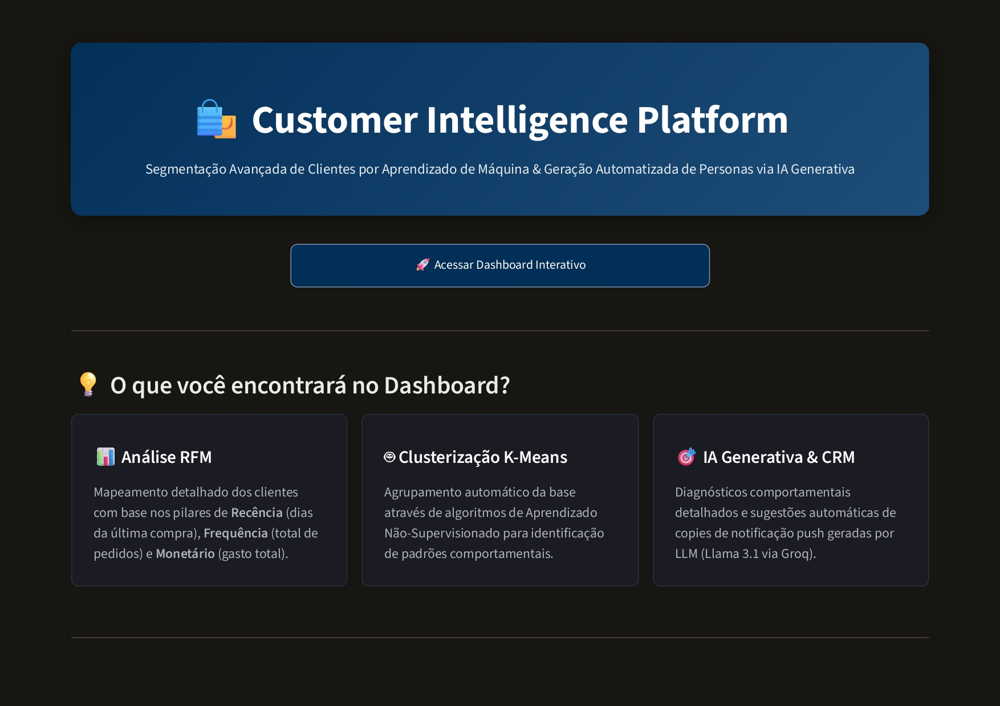
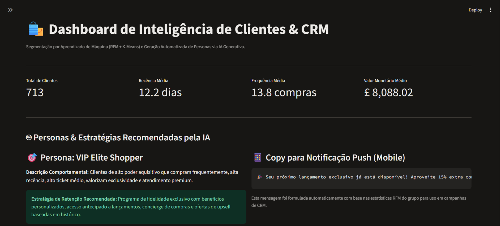
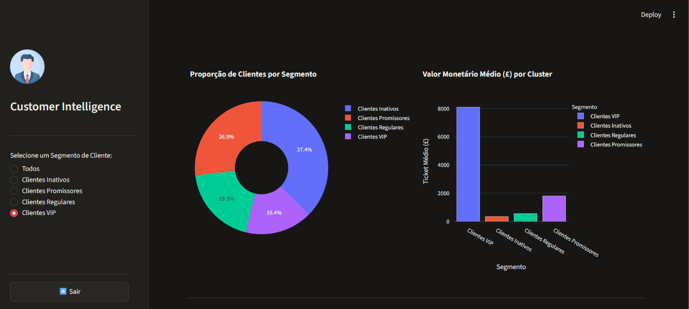

# 🛍️ Customer Intelligence & CRM Platform

> Pipeline *end-to-end* de Ciência de Dados, Machine Learning e IA Generativa para segmentação comportamental de clientes e geração automatizada de estratégias de CRM.

---

## 🎯 Problema de Negócio

Empresas de varejo e e-commerce frequentemente tratam toda a sua base de clientes da mesma forma, disparando campanhas genéricas que geram baixa conversão e alto custo de aquisição/retenção. 

O objetivo deste projeto é resolver esse gargalo dividindo a base de clientes em grupos comportamentais distintos através de **Aprendizado Não-Supervisionado** e utilizando **Modelos de Linguagem (LLMs)** para traduzir métricas estatísticas em personas acionáveis e recomendações de marketing personalizadas.

---

## 🏗️ Arquitetura da Solução

O projeto foi estruturado em 4 etapas principais:

1. **Engenharia de Dados & Análise Exploratória (EDA):**
   - Limpeza de registros nulos, remoção de devoluções/cancelamentos e tratamento de anomalias.
2. **Clusterização com Machine Learning:**
    - Construção da matriz **RFM** (*Recency*, *Frequency*, *Monetary*) por cliente, seguida de transformação logarítmica (`np.log1p`) para suavizar assimetrias extremas.
   - Padronização das variáveis com `StandardScaler` para eliminar viés de escala.
   - Aplicação do algoritmo **K-Means** (validado via Método do Cotovelo e *Silhouette Score*) para identificar segmentos naturais de comportamento.
3. **IA Generativa Aplicada a Negócios (Context-Driven LLM):**
   - Os resultados estatísticos consolidados de cada segmento (médias e medianas de Recência, Frequência e Valor Monetário) são estruturados e fornecidos como **contexto** para um LLM (**openai/gpt-oss-120b** via **Groq API**).
   - A partir desses dados reais, o modelo gera personas detalhadas, diagnósticos comportamentais, recomendações estratégicas de CRM e *copies* prontas para notificações *push*.
4. **Camada de Apresentação & Exploração (Dashboard):**
   - Desenvolvido em **Streamlit** com estilização customizada (CSS) e gráficos interativos em **Plotly**.
   - Atua como a camada final de entrega do produto de dados, permitindo que times de negócio e marketing filtrem segmentos, explorem a distribuição dos clusters e acessem as estratégias geradas pela IA.

---

## 📊 Resultados & Insights Obtidos

* **Volume Analisado:** O dataset original contém `541.909` registros. Após a limpeza, remoção de cancelamentos, tratamento dos dados e eliminação de duplicatas, foram obtidos **`392.692` registros de compras**, resultando em uma base consolidada de **`4.338` clientes únicos** segmentados.

* **Segmentação Identificada (4 Clusters):**
  * 🏆 **Clientes VIPs:** Clientes com baixíssima recência (compraram recentemente), altíssima frequência e maior valor monetário acumulado — foco em programas de fidelidade e acesso antecipado.
 
  * 🔄 **Clientes Regulares:** Compram com boa frequência e valor monetário acumulado médio consistente — foco em *cross-sell* e aumento de ticket.
 
  * 🌱 **Clientes Promissores:** Compraram recentemente, mas ainda possuem baixa frequência — foco em *onboarding* e incentivo à segunda compra.
 
  * ⚠️ **Clientes Inativos / Em Risco:** Alta recência (muitos dias sem comprar) e baixa frequência de compras — foco em campanhas de reativação e cupons de retorno.

* **Entrega da IA Generativa:** O pipeline automatizou a criação de **4 perfis completos de Personas** estruturados em JSON (`personas.json`), traduzindo métricas numéricas em planos de retenção e mensagens diretas de CRM prontas para disparo.

---

## 🛠️ Tech Stack

- **Linguagem:** Python 3.14
- **Manipulação de Dados:** Pandas, NumPy
- **Machine Learning:** Scikit-Learn (`StandardScaler`, `KMeans`)
- **IA Generativa:** Groq API (`openai/gpt-oss-120b`)
- **Visualização & Camada de Apresentação:** Streamlit, Plotly Express, HTML/CSS customizado
- **Gestão de Ambiente:** Virtualenv (`.venv`), `python-dotenv`

---
## 📸 Preview da Aplicação

### 1. Landing Page


### 2. Dashboard Executivo & Personas Geradas por IA


### 3. Análise Visual dos Clusters (K-Means)

---

## 📂 Estrutura do Projeto

```text
customer-intelligence-ml/
├── assets/
│   ├── home.css                   # Estilização exclusiva da Landing Page
│   └── style.css                  # Estilização do Dashboard principal
├── data/
│   ├── raw/                       # Dados brutos originais
│   └── processed/                 # Bases tratadas e artefatos intermediários
├── notebooks/
│   ├── 01_exploratory_data_analysis.ipynb
│   ├── 02_customer_segmentation.ipynb
│   └── 03_cluster_analysis.ipynb
├── app.py                         # Aplicação principal do Dashboard (KPIs, Gráficos, Personas)
├── home.py                        # Entrypoint e gerenciador de rotas (st.navigation)
├── views_home.py                  # Interface da Landing Page
├── personas.json                  # Estratégias e copies geradas via LLM
├── resumo_clusters_rfm.csv        # Métricas consolidadas por segmento
├── rfm_segmented_customers.csv    # Base de clientes classificados por cluster
├── .gitignore                     # Arquivos ignorados pelo Git (incluindo .env)
├── requirements.txt               # Dependências do projeto
└── README.md                      # Documentação do projeto